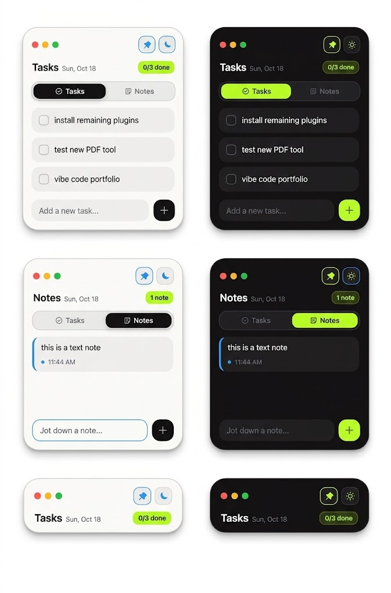

# Squircle Tasks Widget

A compact, modern desktop widget for managing quick tasks and notes with a sleek squircle aesthetic. Built with Electron for a lightweight, distraction-free desktop experience.



---

## ✨ Features

- **Compact & Collapsible** — Minimalist footprint that expands smoothly when you need it.
- **Tasks & Notes in One Place** — Switch between your daily checklist and scratchpad notes effortlessly.
- **Dark & Light Themes** — Beautiful curated color palettes tailored for day and night workflows.
- **Desktop Integration** — Frameless draggable window, Always-on-Top pin, and background System Tray support.
- **Remembers Window Position** — Stays right where you left it on your desktop across restarts.

---

## 🚀 Getting Started

### Prerequisites
Make sure you have [Node.js](https://nodejs.org/) installed.

### Installation

1. Clone the repository:
   ```bash
   git clone https://github.com/usmanjson/squircle-widget.git
   cd squircle-widget
   ```

2. Install dependencies:
   ```bash
   npm install
   ```

3. Launch the widget:
   ```bash
   npm start
   ```

### Build Executable (Windows)

To generate a standalone Windows installer (`.exe`):
```bash
npm run build
```
The output installer will be created inside the `dist/` directory.

---

## 🛠️ Built With

- **[Electron](https://www.electronjs.org/)** — Desktop app runtime
- **HTML5 / Vanilla CSS / JavaScript** — Clean, performant UI with no heavy frameworks
